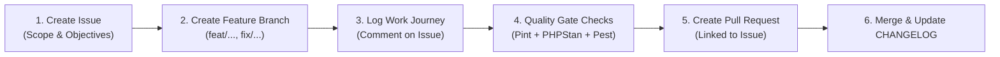

# AGENTS.md — Development Guidelines for AI & Contributors

This document defines the strict engineering standards, branch lifecycle policies, issue-driven development protocols, and release workflows for **`dewanlab/laravel-zkteco-adms-core`**.

All AI agents (Claude, Gemini, Antigravity, Copilot) and human contributors **must** adhere to these rules without exception.

---

## 1. Issue-Driven Development & Work Journey Protocol

Every non-trivial task, feature, or bug fix must follow the **Issue-Driven Workflow**:



### Protocol Directives

1. **GitHub Issue First**: Before starting any task, create or identify the associated GitHub Issue outlining the problem statement, objectives, and proposed plan.
2. **Dedicated Branch**: Never commit directly to `main` for new features or fixes. Branch naming convention:
   - `feat/<short-description>` or `feat/<issue-number>-<description>`
   - `fix/<short-description>` or `fix/<issue-number>-<description>`
   - `docs/<short-description>`
   - `refactor/<short-description>`
3. **Continuous Work Journey Updates**:
   - As milestones or major steps are accomplished, add structured progress comments on the issue detailing decisions made, edge cases handled, and test outcomes.
4. **Issue Linkage**: Reference the issue in commits (`fixes #12` or `refs #12`) and link PRs to auto-close the issue on merge.

---

## 2. Project Standards & Architecture

- **PHP Compatibility**: PHP 8.2 to PHP 8.5+.
- **Framework Support**: Laravel 10.x, 11.x, and 12.x.
- **Strict Typing**: All files must declare `declare(strict_types=1);`.
- **Static Analysis**: Must pass **PHPStan / Larastan at Level 8** with zero errors (`composer run types:check`).
- **Code Formatting**: Must conform to **Laravel Pint** standards (`composer run format`).
- **Test-Driven Rigor**: Every bug fix or new feature requires dedicated **Pest** unit/feature tests covering positive paths and hardware failure modes. All tests must pass before merging.
- **Documentation**: All public/protected classes, enums, DTOs, methods, and properties must have comprehensive PHPDoc blocks explaining hardware context, wire formatting, and edge cases.

---

## 3. Version Management & Semantic Versioning (SemVer 2.0.0)

This repository follows strict [Semantic Versioning 2.0.0](https://semver.org/): `vMAJOR.MINOR.PATCH`.

```text
       v1.2.3
        │ │ └── PATCH: Bug fixes, parser hardening, internal refactoring (no API break)
        │ └──── MINOR: New features, new commands/enums, backward-compatible additions
        └────── MAJOR: Breaking changes (schema changes, renamed public APIs, bumped min PHP/Laravel)
```

### When to Bump Versions

#### Patch (`v0.1.X` / `v1.0.X`)

- Bug fixes in parsers (e.g., handling a new variant of corrupted timestamps or trailing whitespace).
- Firmware bug workarounds without changing public signatures.
- Internal performance enhancements or refactoring.
- Documentation updates or typo corrections.
- Dependency updates that do not alter public behavior.

#### Minor (`v0.X.0` / `v1.X.0`)

- Adding new hardware commands to `DeviceCommandBuilder`.
- Adding new DTOs or helper methods to the `ZktecoAdms` facade.
- Adding new enum cases (e.g., a newly discovered biometric modality or punch state).
- Adding new lifecycle events.
- Introducing new optional configuration options in `zkteco-adms-core.php`.
- **Rule**: Completely backward-compatible with existing consumers.

#### Major (`vX.0.0`)

- Any backward-incompatible change in the public API (`ZktecoAdms`, `DeviceCommandBuilder`, `CommandQueueManager`).
- Renaming or deleting public methods/properties.
- Altering the database schema in a way that requires manual data migrations.
- Dropping support for an older PHP version (e.g., dropping PHP 8.2) or Laravel version (e.g., dropping Laravel 10).

---

## 4. Changelog & Release Workflow

### Changelog Maintenance (`CHANGELOG.md`)

- Follows [Keep a Changelog](https://keepachangelog.com/en/1.1.0/).
- Every pull request must append an entry under the `[Unreleased]` section.
- Allowed categories:
  - `Added`: for new features.
  - `Changed`: for changes in existing functionality.
  - `Deprecated`: for soon-to-be removed features.
  - `Removed`: for now removed features.
  - `Fixed`: for bug fixes.
  - `Security`: in case of vulnerabilities.

### Release Procedure Checklist

Before creating a release tag:

1. **Lint Check**: Run `vendor/bin/pint --test` (must pass clean).
2. **Type Check**: Run `composer run types:check` (must report `[OK] No errors`).
3. **Test Suite**: Run `composer test` (100% tests must pass).
4. **Changelog**: Move items from `[Unreleased]` to a new version header with date (e.g., `## [1.0.0] - 2026-10-03`).
5. **Git Tag**: Create an annotated git tag:

   ```bash
   git tag -a v1.0.0 -m "Release v1.0.0: Initial enterprise release"
   git push github main --tags
   ```

6. **GitHub Release**: Draft release notes matching the changelog entry.

---

## 5. Hardware Safety Directives for ZKTeco Firmware

When adding or modifying protocol logic:

- **Authorization Stacking Bug**: Never issue `DATA UPDATE userauthorize` directly. Always emit `DATA DELETE userauthorize Pin=...` before applying the update.
- **Batched Command Limits**: Never exceed 200 commands or 40,960 bytes per polling response to `/iclock/getrequest`.
- **Cursor Resets**: Never assume edge device clocks or cursors (`Stamp`) are permanent. Always enforce database unique indexes on `(device_id, pin, recorded_at)` for idempotent deduplication.
- **Hardware RTC Drift**: Always sanitize timestamps against year-2000 epoch drops (battery failure on edge RTC modules).
